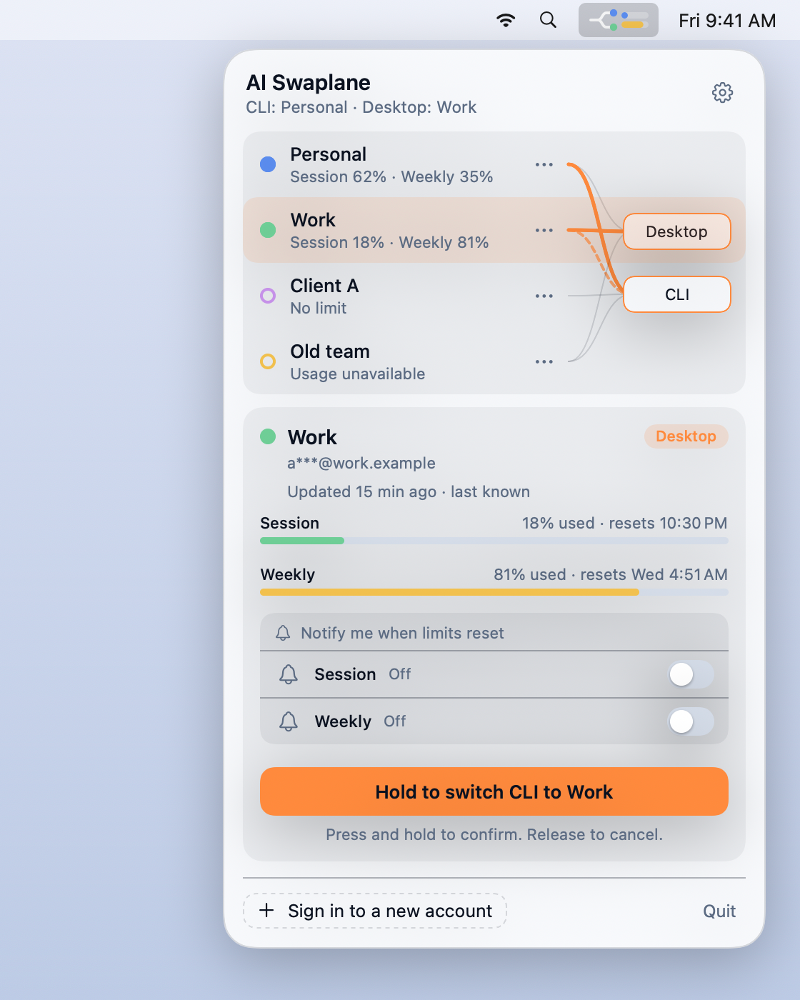
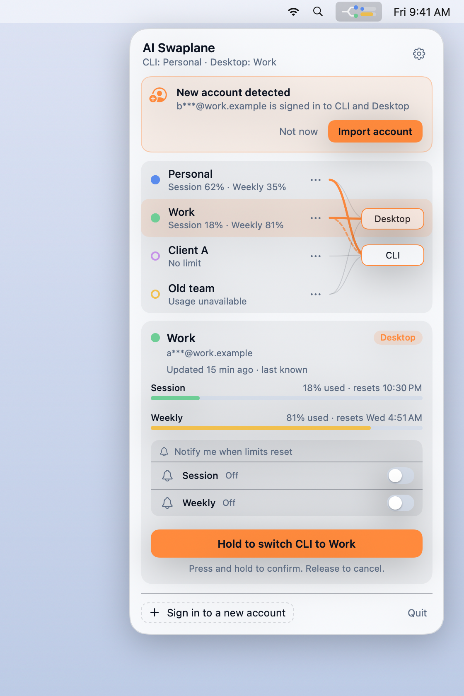

<p align="center">
  <picture>
    <source media="(prefers-color-scheme: dark)" srcset="docs/images/icon-dark.png">
    
  </picture>
</p>

<h1 align="center">AI Swaplane</h1>

<p align="center">
  Switch between your Claude accounts from the macOS menu bar.<br>
  Claude Code and Claude Desktop, one hold of a button, and each account keeps its own state.
</p>

<table align="center">
  <tr>
    <td align="center" valign="top" width="50%">
      <picture>
        <source media="(prefers-color-scheme: dark)" srcset="docs/images/menubar-dark.png">
        
      </picture>
      <br>
      <sub>Switch accounts with one hold of a button.</sub>
    </td>
    <td align="center" valign="top" width="50%">
      <picture>
        <source media="(prefers-color-scheme: dark)" srcset="docs/images/menubar-import-dark.png">
        
      </picture>
      <br>
      <sub>Accounts you sign in to are detected and offered for import.</sub>
    </td>
  </tr>
</table>

> AI Swaplane is an independent open-source project. It is not affiliated with or endorsed by Anthropic.

## Install

**Requirements:** macOS 14 or newer, and Claude Code and/or Claude Desktop.

### Homebrew

```bash
brew install --cask ramysabryali/tap/ai-swaplane
```

Update with `brew upgrade --cask ai-swaplane`. Remove with `brew uninstall --cask --zap ai-swaplane`.

### Build and install from source

You need Xcode 16 or newer (or the Swift 6 toolchain).

```bash
git clone https://github.com/ramysabryali/ai-swaplane.git
cd ai-swaplane
./scripts/install.sh
```

The script builds a release app and copies `AI Swaplane.app` to `/Applications` (or `~/Applications` if that isn't writable). Use `--dir <folder>` to pick another place.

### Download

Grab `AI-Swaplane-<version>.zip` from the [Releases](https://github.com/ramysabryali/ai-swaplane/releases) page, unzip it, and drag **AI Swaplane** to Applications.

Releases that aren't notarized show a Gatekeeper warning on first launch. Right-click the app, choose **Open**, then **Open** again. Or run:

```bash
xattr -dr com.apple.quarantine "/Applications/AI Swaplane.app"
```

### First launch

AI Swaplane lives in the menu bar and has no Dock icon until a window is open. A short welcome tour opens the first time; reopen it from **Settings > About**. macOS asks once to let it read the "Claude Code-credentials" item in your Keychain, which it needs for usage numbers. Choose **Always Allow**.

## Use it

1. Sign in to Claude Code and Claude Desktop with your first account. AI Swaplane notices it and offers **Import account**. Detection stays on, so any account you sign in to later is offered the same way.
2. To add an account you haven't signed in to yet, choose **Add account > Sign in to a new account…**. It saves your current account, clears the local sign-in, waits while you sign in as the new account, then offers to import it. **Cancel and restore** puts your previous account back.
3. Select an account in the list and **hold** the orange button for about a second to switch. Release early to cancel.

An account holds a Claude Code sign-in and a Claude Desktop sign-in together, so one switch moves both. Pick **CLI only** or **Desktop only** to move just one. Claude Desktop is quit and reopened during a switch.

Settings (the gear icon) has appearance, sound, motion, usage, and privacy options. A small read-only command-line tool is bundled at `AI Swaplane.app/Contents/Resources/bin/swaplane`. `swaplane list` shows your saved accounts.

## Privacy and security

- Sign-ins are encrypted with AES-256-GCM. The keys live in your macOS Keychain, and no token or key is written to disk in plain text.
- There is no telemetry, analytics, or crash upload.
- The only network request is the optional usage check to `api.anthropic.com`, using the sign-in you already have. Turn it off under **Settings > General > Show usage limits**.
- AI Swaplane never refreshes or rotates tokens on its own.
- It is not sandboxed because it has to read and write other apps' data folders. The source is here so you can check what it does. See [docs/SECURITY.md](docs/SECURITY.md) for the threat model.

Report a vulnerability through [SECURITY.md](SECURITY.md), not a public issue.

## Known limits

- It works with Claude Code and Claude Desktop only. Other tools are not supported.
- It relies on how those apps store their sign-in today. Anthropic can change that without notice, and a new version of either app may stop working until AI Swaplane is updated.
- The usage numbers come from an undocumented endpoint. If it changes, usage shows as unavailable and switching keeps working.
- Usage for accounts you aren't signed in to right now is the last number seen. Sign-ins expire, and AI Swaplane won't refresh them for you.

## Uninstall

Installed with Homebrew? Remove it with Homebrew:

```bash
brew uninstall --cask --zap ai-swaplane
```

Otherwise use the script:

```bash
./scripts/uninstall.sh            # removes the app, keeps your saved accounts
./scripts/uninstall.sh --purge    # also deletes saved accounts and their Keychain items
```

Claude Code and Claude Desktop are never touched by uninstalling.

## Troubleshooting

**Homebrew says it's already installed after I deleted the app.** Homebrew keeps its own record of installs. Run `brew reinstall --cask ramysabryali/tap/ai-swaplane`. If that fails, run `brew uninstall --cask --force ai-swaplane` and install again. Your saved accounts are kept.

## Build and test

```bash
swift build
swift test
./scripts/make-app.sh debug     # builds build/AI Swaplane.app
```

Tests use fixtures and a temporary home folder, never your real accounts. See [CONTRIBUTING.md](CONTRIBUTING.md) and [docs/TESTING.md](docs/TESTING.md).

## Responsible use

AI Swaplane is for keeping legitimately separate accounts apart, such as work and personal. It is not designed to get around usage limits or any service's terms. You are responsible for following the terms of the services you use.

## License

[MIT](LICENSE)
